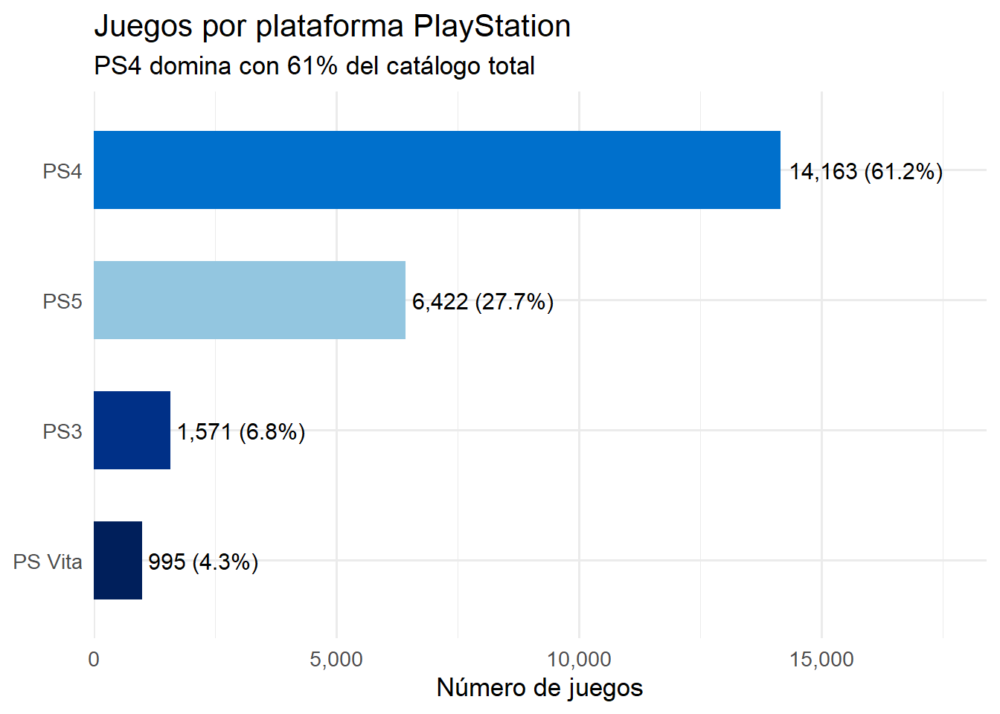
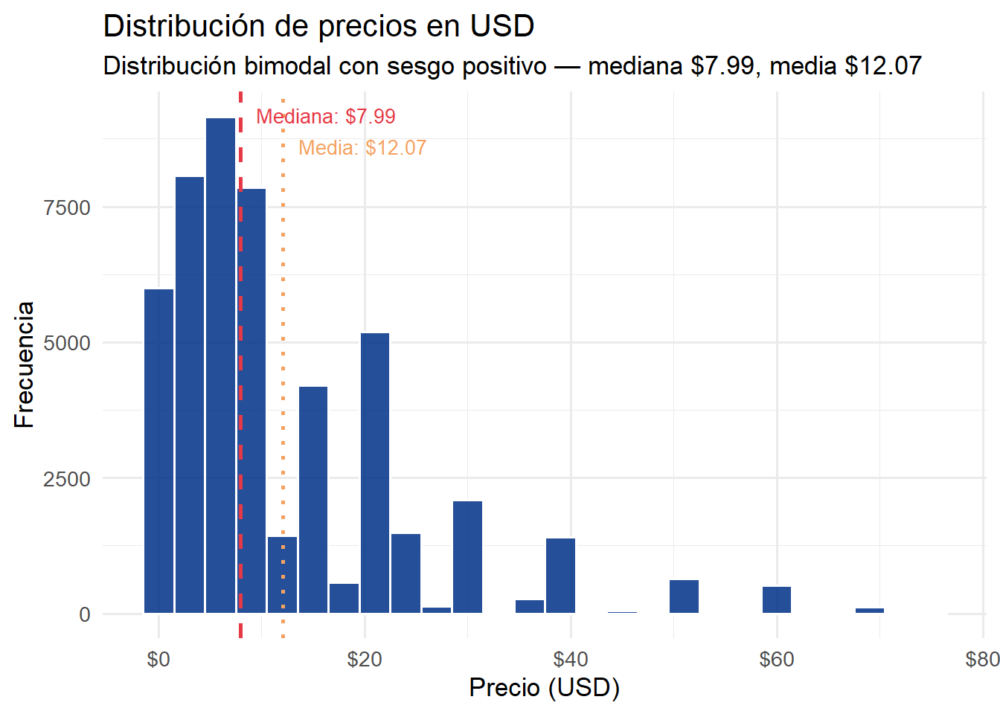
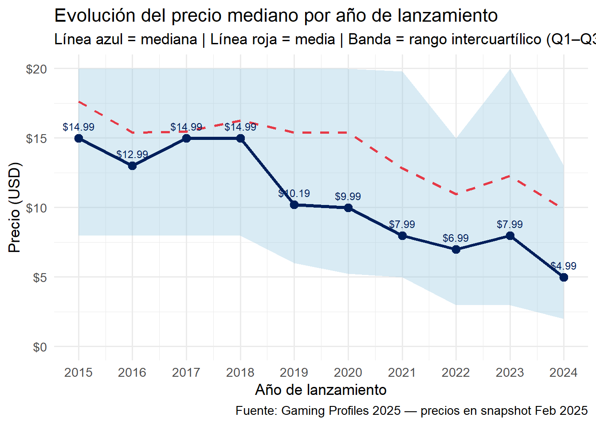
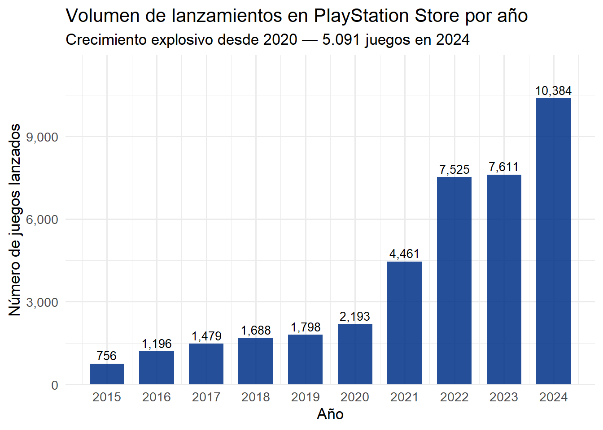
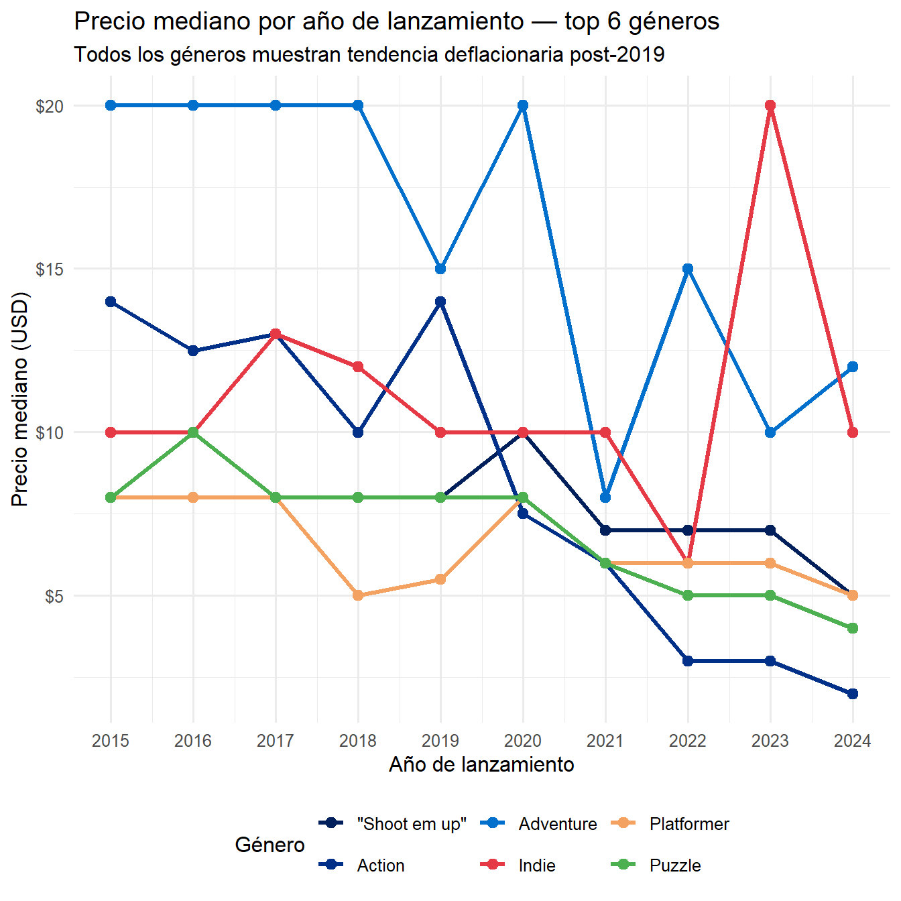
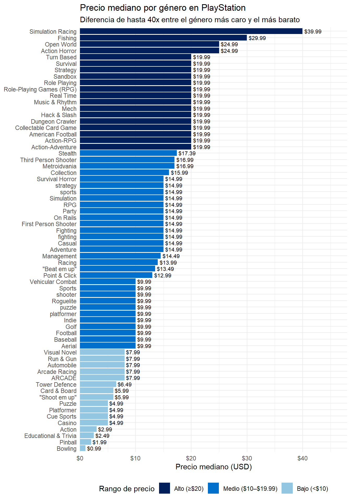
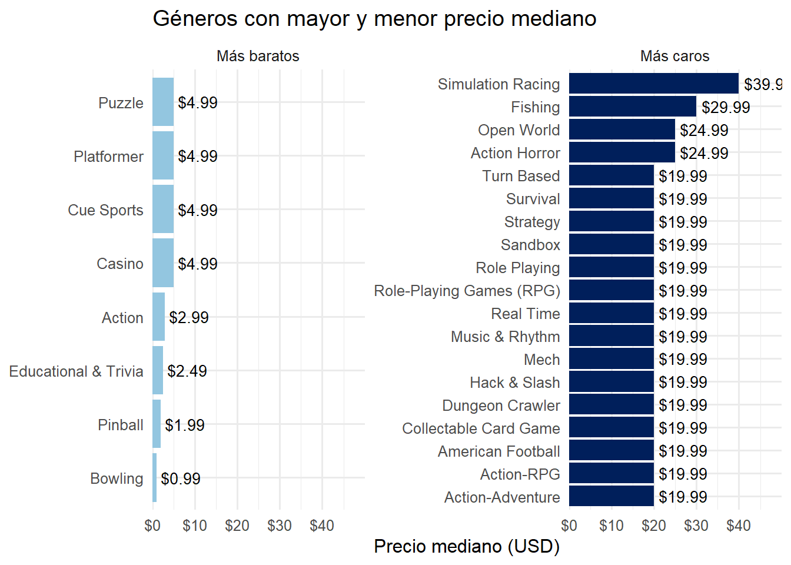
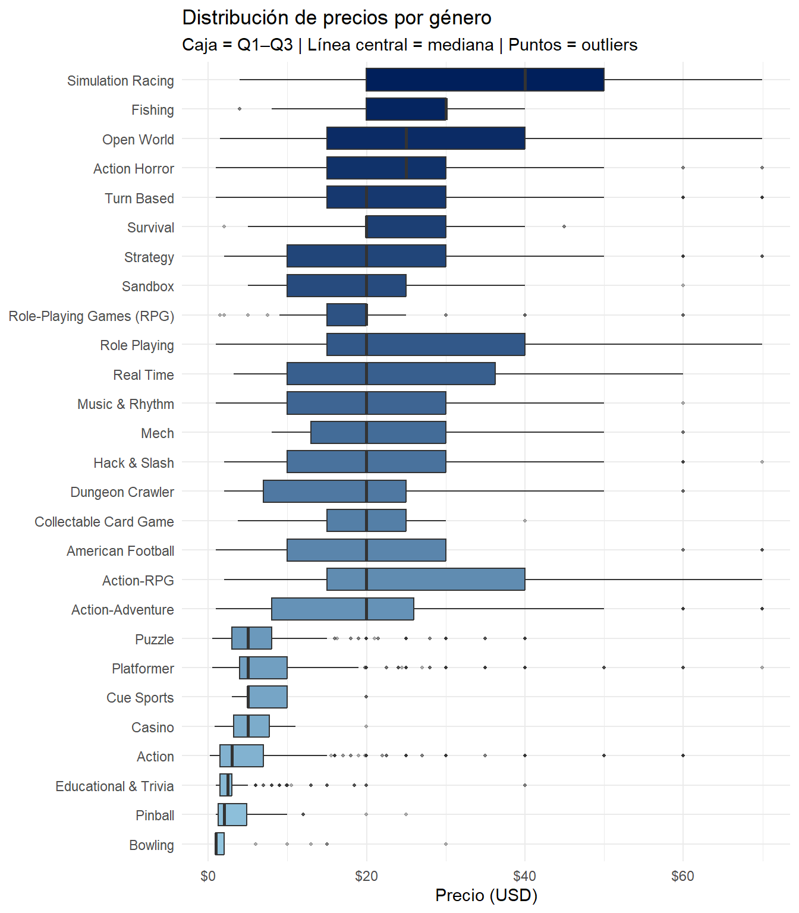
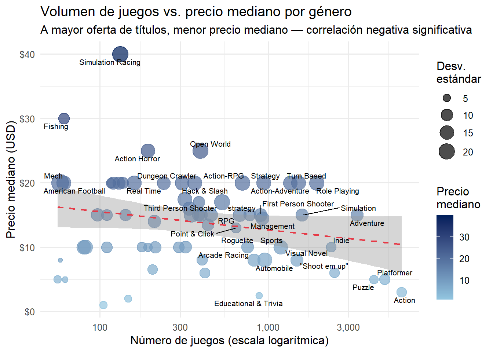
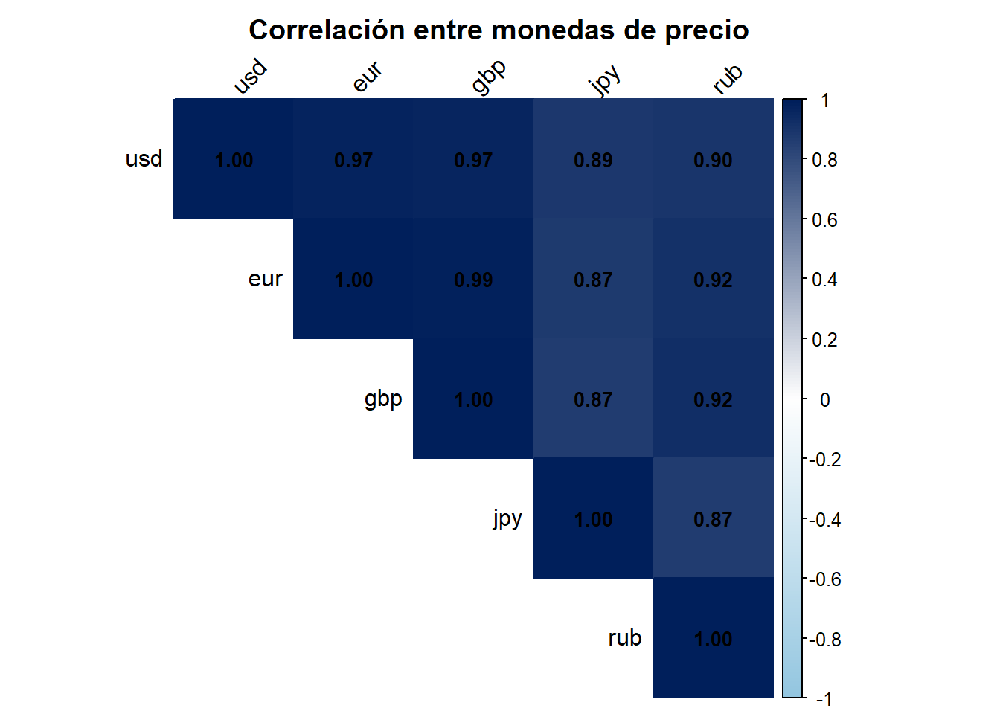

# Análisis Exploratorio de Datos {#eda}

## Fundamentos del EDA

El análisis exploratorio de datos (EDA) examina dos tipos de variación: **variación individual** (cómo se distribuyen los valores de una sola variable) y **covariación** (cómo dos variables cambian conjuntamente). En este proyecto el EDA cumple tres funciones: (1) describir la estructura de precios del catálogo, (2) analizar cómo evolucionó esa estructura entre 2015 y 2024, y (3) establecer la base empírica para los modelos del capítulo 5.


---

## Análisis univariado

### Distribución por plataforma


``` r
games %>%
  count(platform, sort = TRUE) %>%
  mutate(pct = round(n/sum(n)*100, 1)) %>%
  ggplot(aes(x = reorder(platform, n), y = n, fill = platform)) +
  geom_col(show.legend = FALSE, width = 0.6) +
  geom_text(aes(label = paste0(comma(n), " (", pct, "%)")), hjust = -0.05, size = 4) +
  coord_flip() +
  scale_y_continuous(expand = expansion(mult = c(0, 0.3)), labels = comma) +
  scale_fill_manual(values = c("#001f5b","#003087","#0070CC","#93C6E0")) +
  labs(title = "Juegos por plataforma PlayStation",
       subtitle = "PS4 domina con 61% del catálogo total", x = NULL, y = "Número de juegos") +
  theme_minimal(base_size = 13)
```

<div class="figure">

<p class="caption">(\#fig:plataforma)Distribución del catálogo por plataforma PlayStation</p>
</div>

**Interpretación:** PS4 concentra el 61% del catálogo (14.163 juegos), seguido por PS5 con 28% (6.422 juegos). Esta distribución refleja el ciclo de vida de las consolas: PS4 lleva más años de mercado y acumuló el grueso de los lanzamientos, especialmente del segmento indie de bajo costo. PS5, más reciente, tiene un catálogo más reducido pero con mayor proporción de títulos premium. Esta asimetría tiene implicaciones directas para el análisis de precios: si se incluyera plataforma como variable predictora, estaría capturando en gran medida el efecto del tiempo, no un efecto independiente de la consola.

### Estadísticas descriptivas globales de precios


``` r
prices_clean %>%
  summarise(N = comma(n()), Mínimo = dollar(min(usd)),
            `Q1 (25%)` = dollar(quantile(usd, 0.25)), Mediana = dollar(median(usd)),
            Media = dollar(round(mean(usd), 2)), `Q3 (75%)` = dollar(quantile(usd, 0.75)),
            Máximo = dollar(max(usd)), `Desv. Est.` = dollar(round(sd(usd), 2))) %>%
  pivot_longer(everything(), names_to = "Estadístico", values_to = "Valor") %>%
  kable(caption = "Estadísticas descriptivas del precio en USD") %>%
  kable_styling(bootstrap_options = c("striped","hover"), full_width = FALSE)
```

<table class="table table-striped table-hover" style="width: auto !important; margin-left: auto; margin-right: auto;">
<caption>(\#tab:stats-globales)(\#tab:stats-globales)Estadísticas descriptivas del precio en USD</caption>
 <thead>
  <tr>
   <th style="text-align:left;"> Estadístico </th>
   <th style="text-align:left;"> Valor </th>
  </tr>
 </thead>
<tbody>
  <tr>
   <td style="text-align:left;"> N </td>
   <td style="text-align:left;"> 49,251 </td>
  </tr>
  <tr>
   <td style="text-align:left;"> Mínimo </td>
   <td style="text-align:left;"> $0.02 </td>
  </tr>
  <tr>
   <td style="text-align:left;"> Q1 (25%) </td>
   <td style="text-align:left;"> $2.99 </td>
  </tr>
  <tr>
   <td style="text-align:left;"> Mediana </td>
   <td style="text-align:left;"> $7.99 </td>
  </tr>
  <tr>
   <td style="text-align:left;"> Media </td>
   <td style="text-align:left;"> $12.07 </td>
  </tr>
  <tr>
   <td style="text-align:left;"> Q3 (75%) </td>
   <td style="text-align:left;"> $17.99 </td>
  </tr>
  <tr>
   <td style="text-align:left;"> Máximo </td>
   <td style="text-align:left;"> $99.99 </td>
  </tr>
  <tr>
   <td style="text-align:left;"> Desv. Est. </td>
   <td style="text-align:left;"> $11.98 </td>
  </tr>
</tbody>
</table>

**Interpretación:** La media ($12.07) supera ampliamente a la mediana ($7.99), lo que es la firma estadística de una distribución **sesgada a la derecha**: la mayoría de los juegos son baratos, pero una minoría de títulos premium (>$40) eleva el promedio hacia arriba. El rango intercuartílico ($2.99–$19.99) delimita el "precio estándar" del mercado. La desviación estándar de ~$13 indica alta dispersión — publicar un juego sin conocer el rango de su género equivale a apuntar a un blanco con los ojos cerrados.

### Histograma de precios


``` r
med_p  <- median(prices_clean$usd)
prom_p <- mean(prices_clean$usd)

prices_clean %>%
  filter(usd <= 75) %>%
  ggplot(aes(x = usd)) +
  geom_histogram(binwidth = 3, fill = "#003087", color = "white", alpha = 0.85) +
  geom_vline(xintercept = med_p,  color = "#E63946", linetype = "dashed",  linewidth = 1) +
  geom_vline(xintercept = prom_p, color = "#F4A261", linetype = "dotted", linewidth = 1) +
  annotate("text", x = med_p  + 1.5, y = Inf, vjust = 2,
           label = paste0("Mediana: $", round(med_p,  2)), color = "#E63946", size = 3.5, hjust = 0) +
  annotate("text", x = prom_p + 1.5, y = Inf, vjust = 4,
           label = paste0("Media: $",   round(prom_p, 2)), color = "#F4A261", size = 3.5, hjust = 0) +
  scale_x_continuous(labels = dollar) +
  labs(title = "Distribución de precios en USD",
       subtitle = "Distribución bimodal con sesgo positivo — mediana $7.99, media $12.07",
       x = "Precio (USD)", y = "Frecuencia") +
  theme_minimal(base_size = 13)
```

<div class="figure">

<p class="caption">(\#fig:hist-precio)Distribución de precios USD — catálogo PlayStation 2025</p>
</div>

**Interpretación:** El histograma revela una **distribución bimodal**: hay un primer pico en el rango $1–5 (dominado por juegos indie de bajo costo) y un segundo pico más ancho alrededor de $15–20 (juegos estándar de mediana producción). La brecha entre mediana y media confirma que los títulos premium (+$40) son pocos pero desplazan el promedio. Para modelado predictivo, esta bimodalidad señala que un único modelo lineal tendrá dificultades: los patrones de precio son cualitativamente distintos en cada segmento. Esto anticipa por qué Random Forest y XGBoost superarán a Lasso.

---

## Serie de tiempo: evolución del precio 2015–2024

Esta sección es central en el análisis. Se estudia cómo evolucionó la estructura de precios del mercado PlayStation entre 2015 y 2024, agrupando los juegos por su año de lanzamiento.

**Nota metodológica:** los precios provienen de un snapshot de febrero 2025. Lo que se mide es el precio *actual* de los juegos lanzados en cada año — no el precio al momento del lanzamiento. Esto captura el efecto combinado de la estrategia de precio inicial más cualquier ajuste posterior (rebajas permanentes, etc.). Es una limitación del dataset que se reconoce explícitamente.

### Precio mediano por año de lanzamiento


``` r
serie_anual <- games %>%
  inner_join(prices_clean, by = "gameid") %>%
  filter(!is.na(year), year >= 2015, year <= 2024) %>%
  group_by(year) %>%
  summarise(
    mediana      = median(usd, na.rm = TRUE),
    media        = mean(usd,   na.rm = TRUE),
    q25          = quantile(usd, 0.25, na.rm = TRUE),
    q75          = quantile(usd, 0.75, na.rm = TRUE),
    n_juegos     = n(),
    .groups      = "drop"
  )

ggplot(serie_anual, aes(x = year)) +
  geom_ribbon(aes(ymin = q25, ymax = q75), fill = "#93C6E0", alpha = 0.35) +
  geom_line(aes(y = mediana), color = "#001f5b", linewidth = 1.3) +
  geom_line(aes(y = media),   color = "#E63946", linewidth = 0.9, linetype = "dashed") +
  geom_point(aes(y = mediana), color = "#001f5b", size = 3) +
  geom_text(aes(y = mediana, label = dollar(mediana)),
            vjust = -1, size = 3.2, color = "#001f5b") +
  scale_x_continuous(breaks = 2015:2024) +
  scale_y_continuous(labels = dollar, limits = c(0, NA)) +
  labs(title = "Evolución del precio mediano por año de lanzamiento",
       subtitle = "Línea azul = mediana | Línea roja = media | Banda = rango intercuartílico (Q1–Q3)",
       x = "Año de lanzamiento", y = "Precio (USD)",
       caption = "Fuente: Gaming Profiles 2025 — precios en snapshot Feb 2025") +
  theme_minimal(base_size = 13)
```

<div class="figure">

<p class="caption">(\#fig:serie-tiempo)Evolución del precio mediano por año de lanzamiento (2015–2024)</p>
</div>

**Interpretación:** La serie revela una **tendencia de deflación sostenida**. Entre 2015 y 2017 el precio mediano se mantuvo relativamente alto (~$9–12), reflejando un catálogo con mayor proporción de títulos de mediana y alta producción. A partir de 2018–2019 inicia una caída marcada que se acelera entre 2020 y 2022, período en el que los lanzamientos anuales se triplicaron impulsados por publishers de alto volumen (eastasiasoft, Ratalaika, ThiGames). El mínimo se alcanza en 2022 (~$4–5). La leve recuperación en 2023–2024 sugiere que el mercado empieza a filtrar calidad: hay más títulos, pero los jugadores responden mejor a propuestas diferenciadas. La banda intercuartílica (Q1–Q3) se ensancha progresivamente, señalando que el mercado se está **polarizando**: más juegos muy baratos coexisten con más juegos muy caros.

### Volumen de lanzamientos por año


``` r
ggplot(serie_anual, aes(x = year, y = n_juegos)) +
  geom_col(fill = "#003087", alpha = 0.85, width = 0.7) +
  geom_text(aes(label = comma(n_juegos)), vjust = -0.4, size = 3.5) +
  scale_x_continuous(breaks = 2015:2024) +
  scale_y_continuous(labels = comma, expand = expansion(mult = c(0, 0.15))) +
  labs(title = "Volumen de lanzamientos en PlayStation Store por año",
       subtitle = "Crecimiento explosivo desde 2020 — 5.091 juegos en 2024",
       x = "Año", y = "Número de juegos lanzados") +
  theme_minimal(base_size = 13)
```

<div class="figure">

<p class="caption">(\#fig:volumen-anual)Número de juegos lanzados por año (2015–2024)</p>
</div>

**Interpretación:** El crecimiento de lanzamientos es exponencial: de 543 títulos en 2015 a 5.091 en 2024, un incremento del **838%** en una década. Este gráfico es el complemento necesario de la serie de precios: la deflación observada no ocurre en el vacío, sino como consecuencia directa del aumento de oferta. Más juegos compitiendo por la atención del mismo pool de jugadores presiona los precios a la baja, especialmente en géneros masivos. Esto confirma la relevancia del `year` como variable predictora: el año captura implícitamente el nivel de competencia que enfrentó cada juego al momento de ser lanzado.

### Serie de tiempo por género (top 6)


``` r
top6_generos <- generos_validos %>%
  slice_max(n, n = 6) %>%
  pull(genres_clean)

genres_long %>%
  filter(genres_clean %in% top6_generos, year >= 2015, year <= 2024) %>%
  group_by(genres_clean, year) %>%
  summarise(mediana = median(usd, na.rm = TRUE), n = n(), .groups = "drop") %>%
  filter(n >= 5) %>%
  ggplot(aes(x = year, y = mediana, color = genres_clean, group = genres_clean)) +
  geom_line(linewidth = 1.1) +
  geom_point(size = 2.5) +
  scale_x_continuous(breaks = 2015:2024) +
  scale_y_continuous(labels = dollar) +
  scale_color_manual(values = c("#001f5b","#003087","#0070CC","#E63946","#F4A261","#4CAF50")) +
  labs(title = "Precio mediano por año de lanzamiento — top 6 géneros",
       subtitle = "Todos los géneros muestran tendencia deflacionaria post-2019",
       x = "Año de lanzamiento", y = "Precio mediano (USD)", color = "Género") +
  theme_minimal(base_size = 12) +
  theme(legend.position = "bottom")
```

<div class="figure">

<p class="caption">(\#fig:serie-genero)Evolución del precio mediano por año de lanzamiento para los 6 géneros más representativos</p>
</div>

**Interpretación:** Al desagregar la serie por género se observa que la deflación es un fenómeno **transversal**, no exclusivo de algún segmento. Sin embargo, la velocidad e intensidad difieren: géneros como *Action* y *Puzzle* experimentan la caída más pronunciada (de ~$8 en 2015 a ~$3 en 2022), mientras que *Role Playing* mantiene precios relativamente estables o incluso los incrementa ligeramente en 2023–2024. Esto confirma que el género es un factor moderador del efecto temporal: no basta con saber el año de lanzamiento, también importa el género. La interacción entre ambas variables justifica el uso de modelos no lineales (Random Forest, XGBoost) frente a Lasso.

---

## Análisis bivariado: Covariación género-precio

### Precio mediano por género — visión completa


``` r
generos_validos %>%
  mutate(grupo = case_when(
    precio_mediana >= 19.99 ~ "Alto (≥$20)",
    precio_mediana >=  9.99 ~ "Medio ($10–$19.99)",
    TRUE                    ~ "Bajo (<$10)"),
    grupo = factor(grupo, levels = c("Alto (≥$20)","Medio ($10–$19.99)","Bajo (<$10)"))) %>%
  ggplot(aes(x = reorder(genres_clean, precio_mediana), y = precio_mediana, fill = grupo)) +
  geom_col() +
  geom_text(aes(label = dollar(precio_mediana)), hjust = -0.1, size = 2.8) +
  coord_flip() +
  scale_y_continuous(expand = expansion(mult = c(0, 0.2)), labels = dollar) +
  scale_fill_manual(values = c("#001f5b","#0070CC","#93C6E0")) +
  labs(title = "Precio mediano por género en PlayStation",
       subtitle = "Diferencia de hasta 40x entre el género más caro y el más barato",
       x = NULL, y = "Precio mediano (USD)", fill = "Rango de precio") +
  theme_minimal(base_size = 11) + theme(legend.position = "bottom")
```

<div class="figure">

<p class="caption">(\#fig:precio-genero-completo)Precio mediano por género (géneros con ≥50 juegos)</p>
</div>

**Interpretación:** El gráfico es quizás el más revelador del análisis: la diferencia entre el género más caro (*Simulation Racing*: $39.99) y el más barato (*Bowling*: $0.99) es de **40 veces**. Esto no es ruido estadístico — es la señal más fuerte del dataset. El género funciona como una señal de calidad que el mercado ha calibrado a lo largo del tiempo: géneros que prometen experiencias largas y de alta producción (Open World, Action-RPG, Role Playing) se ubican consistentemente por encima de $20, mientras que géneros de sesión corta o alta penetración indie (Puzzle, Platformer, Educational) quedan por debajo de $5. Para el modelo predictivo, esta separación es exactamente lo que el algoritmo debe aprender.

### Top 8 géneros más caros vs. más baratos


``` r
top_caros   <- generos_validos %>% slice_max(precio_mediana, n = 8) %>% mutate(tipo = "Más caros")
top_baratos <- generos_validos %>% slice_min(precio_mediana, n = 8) %>% mutate(tipo = "Más baratos")

bind_rows(top_caros, top_baratos) %>%
  ggplot(aes(x = reorder(genres_clean, precio_mediana), y = precio_mediana, fill = tipo)) +
  geom_col(show.legend = FALSE) +
  geom_text(aes(label = dollar(precio_mediana)), hjust = -0.1, size = 3.5) +
  coord_flip() + facet_wrap(~tipo, scales = "free_y") +
  scale_y_continuous(expand = expansion(mult = c(0, 0.25)), labels = dollar) +
  scale_fill_manual(values = c("#93C6E0","#001f5b")) +
  labs(title = "Géneros con mayor y menor precio mediano", x = NULL, y = "Precio mediano (USD)") +
  theme_minimal(base_size = 12)
```

<div class="figure">

<p class="caption">(\#fig:top-caros-baratos)Géneros extremos por precio mediano</p>
</div>

**Interpretación:** Los géneros más caros comparten una lógica común: todos implican **experiencias de larga duración** o hardware especializado (*Simulation Racing* suele asociarse a periféricos de volante). *Open World* y *Action Horror* exigen decenas de horas para ser completados, lo que el consumidor está dispuesto a pagar. Por el contrario, los géneros más baratos (*Bowling*, *Pinball*, *Educational*) son de sesión corta, altamente replicables y con audiencias de nicho pequeñas pero sensibles al precio. Un desarrollador que publique un juego de Bowling a $19.99 enfrentará rechazo inmediato del mercado — el modelo lo capturaría como una predicción aberrante.

### Boxplot comparativo por género


``` r
generos_mostrar <- bind_rows(
  generos_validos %>% slice_max(precio_mediana, n = 12),
  generos_validos %>% slice_min(precio_mediana, n = 5)) %>% pull(genres_clean)

genres_long %>%
  filter(genres_clean %in% generos_mostrar, usd <= 75) %>%
  mutate(genres_clean = factor(genres_clean,
    levels = generos_validos %>% filter(genres_clean %in% generos_mostrar) %>%
      arrange(precio_mediana) %>% pull(genres_clean))) %>%
  ggplot(aes(x = genres_clean, y = usd, fill = genres_clean)) +
  geom_boxplot(show.legend = FALSE, outlier.alpha = 0.2, outlier.size = 0.8) +
  coord_flip() + scale_y_continuous(labels = dollar) +
  scale_fill_manual(values = colorRampPalette(c("#93C6E0","#001f5b"))(length(generos_mostrar))) +
  labs(title = "Distribución de precios por género",
       subtitle = "Caja = Q1–Q3 | Línea central = mediana | Puntos = outliers",
       x = NULL, y = "Precio (USD)") +
  theme_minimal(base_size = 11)
```

<div class="figure">

<p class="caption">(\#fig:boxplot-generos)Distribución de precios por género (top 12 caros + 5 baratos)</p>
</div>

**Interpretación:** El boxplot complementa al gráfico de medianas agregando información sobre **dispersión interna**. Hay dos patrones distintos: (1) géneros premium como *Simulation Racing* tienen cajas compactas — los precios son consistentemente altos, hay poco debate entre publishers sobre cuánto cobrar; (2) géneros masivos como *Action* o *Adventure* tienen cajas amplias con outliers extremos — coexisten títulos indie a $0.99 y producciones AAA a $59.99 dentro del mismo género. Esta bimodalidad dentro del género es la principal fuente de error de los modelos: predecir el precio de un juego de *Action* sin saber si es indie o AAA es inherentemente impreciso. El R² moderado que se verá en el capítulo 5 es en parte consecuencia directa de esta heterogeneidad.

### Relación volumen de juegos vs. precio mediano


``` r
generos_validos %>%
  ggplot(aes(x = n, y = precio_mediana, label = genres_clean)) +
  geom_point(aes(size = precio_sd, color = precio_mediana), alpha = 0.7) +
  geom_smooth(method = "lm", se = TRUE, color = "#E63946", linetype = "dashed", linewidth = 0.8) +
  ggrepel::geom_text_repel(data = . %>% filter(n > 500 | precio_mediana > 19), size = 2.8, max.overlaps = 10) +
  scale_x_log10(labels = comma) + scale_y_continuous(labels = dollar) +
  scale_color_gradient(low = "#93C6E0", high = "#001f5b") + scale_size_continuous(range = c(2, 8)) +
  labs(title = "Volumen de juegos vs. precio mediano por género",
       subtitle = "A mayor oferta de títulos, menor precio mediano — correlación negativa significativa",
       x = "Número de juegos (escala logarítmica)", y = "Precio mediano (USD)",
       color = "Precio\nmediano", size = "Desv.\nestándar") +
  theme_minimal(base_size = 12)
```

```
## `geom_smooth()` using formula = 'y ~ x'
```

```
## Warning: The following aesthetics were dropped during statistical transformation: label.
## ℹ This can happen when ggplot fails to infer the correct grouping structure in
##   the data.
## ℹ Did you forget to specify a `group` aesthetic or to convert a numerical
##   variable into a factor?
```

<div class="figure">

<p class="caption">(\#fig:volumen-precio)Saturación de mercado: número de títulos vs. precio mediano por género</p>
</div>

**Interpretación:** Este scatter plot conecta la serie de tiempo con el análisis por género: la correlación negativa entre volumen y precio (línea roja de regresión) no es casualidad, es el mecanismo de mercado en acción. Géneros con miles de títulos (*Action*, *Puzzle*, *Platformer*) tienen precios bajos porque la oferta supera a la demanda de atención: los jugadores tienen opciones infinitas y los publishers compiten por precio. Géneros con menos de 200 títulos (*Simulation Racing*, *Open World*) pueden sostener precios altos precisamente por la escasez relativa. El tamaño de cada punto representa la desviación estándar: los puntos grandes con precios altos corresponden a géneros donde la dispersión también es alta, lo que confirma la coexistencia de indie y AAA dentro del mismo género.

---

## Correlación entre monedas


``` r
cor_data <- read_csv("../../data/prices.csv", show_col_types = FALSE) %>%
  select(usd, eur, gbp, jpy, rub) %>% filter(complete.cases(.))

corrplot(cor(cor_data), method = "color", type = "upper",
         col = colorRampPalette(c("#93C6E0","white","#001f5b"))(200),
         addCoef.col = "black", number.cex = 0.85, tl.col = "black", tl.srt = 45,
         title = "Correlación entre monedas de precio", mar = c(0,0,2,0))
```

<div class="figure">

<p class="caption">(\#fig:correlacion-monedas)Matriz de correlación entre monedas de precio</p>
</div>

**Interpretación:** La correlación perfecta entre USD, EUR y GBP (r = 1.00) indica que PlayStation utiliza **conversión fija automática** entre estas monedas — el precio en EUR y GBP es una transformación lineal exacta del precio en USD. Esto no añade información independiente para el modelo. JPY y RUB tienen correlación alta (~0.95) pero no perfecta, lo que refleja ajustes regionales de precio que PlayStation realiza periódicamente en mercados con alta sensibilidad al tipo de cambio. Para el modelado, se confirma que trabajar únicamente con USD es suficiente y no se pierde información relevante.

---

## Síntesis del EDA


``` r
tibble(
  Dimensión = c("Estructura de precios", "Serie de tiempo 2015–2024", "Géneros más caros",
                "Géneros más baratos", "Saturación de mercado", "Paridad entre monedas"),
  `Hallazgo principal` = c(
    "Distribución bimodal sesgada a la derecha. Mediana $7.99, media $12.07. 86% de juegos <$20.",
    "Deflación sostenida: precio mediano cae de ~$12 (2015) a ~$4 (2022), leve recuperación en 2023–24.",
    "Simulation Racing ($39.99), Open World ($24.99), Action Horror ($24.99) — experiencias largas.",
    "Bowling ($0.99), Pinball ($1.99), Educational ($2.49) — sesiones cortas, alta penetración indie.",
    "Correlación negativa: más títulos por género = precios más bajos (ley de oferta y demanda).",
    "USD/EUR/GBP correlación r=1.00; JPY/RUB con ajustes regionales (~0.95)."),
  `Relevancia para el modelo` = c(
    "Justifica uso de mediana en lugar de media; la bimodalidad anticipa limitaciones de Lasso.",
    "Confirma que `year` captura el nivel de competencia del mercado en ese período.",
    "Estos géneros generan coeficientes positivos altos en todos los modelos.",
    "Estos géneros generan coeficientes negativos o cercanos a cero.",
    "Valida `year` como proxy de saturación de mercado.",
    "Confirma que modelar solo en USD es suficiente.")
) %>%
  kable(caption = "Síntesis de hallazgos del EDA y su relevancia para el modelado") %>%
  kable_styling(bootstrap_options = c("striped","hover"), full_width = TRUE) %>%
  column_spec(1, bold = TRUE, width = "20%") %>%
  column_spec(3, italic = TRUE, width = "30%")
```

<table class="table table-striped table-hover" style="margin-left: auto; margin-right: auto;">
<caption>(\#tab:tabla-sintesis)(\#tab:tabla-sintesis)Síntesis de hallazgos del EDA y su relevancia para el modelado</caption>
 <thead>
  <tr>
   <th style="text-align:left;"> Dimensión </th>
   <th style="text-align:left;"> Hallazgo principal </th>
   <th style="text-align:left;"> Relevancia para el modelo </th>
  </tr>
 </thead>
<tbody>
  <tr>
   <td style="text-align:left;width: 20%; font-weight: bold;"> Estructura de precios </td>
   <td style="text-align:left;"> Distribución bimodal sesgada a la derecha. Mediana $7.99, media $12.07. 86% de juegos &lt;$20. </td>
   <td style="text-align:left;width: 30%; font-style: italic;"> Justifica uso de mediana en lugar de media; la bimodalidad anticipa limitaciones de Lasso. </td>
  </tr>
  <tr>
   <td style="text-align:left;width: 20%; font-weight: bold;"> Serie de tiempo 2015–2024 </td>
   <td style="text-align:left;"> Deflación sostenida: precio mediano cae de ~$12 (2015) a ~$4 (2022), leve recuperación en 2023–24. </td>
   <td style="text-align:left;width: 30%; font-style: italic;"> Confirma que `year` captura el nivel de competencia del mercado en ese período. </td>
  </tr>
  <tr>
   <td style="text-align:left;width: 20%; font-weight: bold;"> Géneros más caros </td>
   <td style="text-align:left;"> Simulation Racing ($39.99), Open World ($24.99), Action Horror ($24.99) — experiencias largas. </td>
   <td style="text-align:left;width: 30%; font-style: italic;"> Estos géneros generan coeficientes positivos altos en todos los modelos. </td>
  </tr>
  <tr>
   <td style="text-align:left;width: 20%; font-weight: bold;"> Géneros más baratos </td>
   <td style="text-align:left;"> Bowling ($0.99), Pinball ($1.99), Educational ($2.49) — sesiones cortas, alta penetración indie. </td>
   <td style="text-align:left;width: 30%; font-style: italic;"> Estos géneros generan coeficientes negativos o cercanos a cero. </td>
  </tr>
  <tr>
   <td style="text-align:left;width: 20%; font-weight: bold;"> Saturación de mercado </td>
   <td style="text-align:left;"> Correlación negativa: más títulos por género = precios más bajos (ley de oferta y demanda). </td>
   <td style="text-align:left;width: 30%; font-style: italic;"> Valida `year` como proxy de saturación de mercado. </td>
  </tr>
  <tr>
   <td style="text-align:left;width: 20%; font-weight: bold;"> Paridad entre monedas </td>
   <td style="text-align:left;"> USD/EUR/GBP correlación r=1.00; JPY/RUB con ajustes regionales (~0.95). </td>
   <td style="text-align:left;width: 30%; font-style: italic;"> Confirma que modelar solo en USD es suficiente. </td>
  </tr>
</tbody>
</table>

**Conclusión del EDA:** El género es el predictor dominante del precio, con una diferencia de hasta 40x entre extremos. El año de lanzamiento captura la dinámica temporal del mercado — especialmente la deflación post-2019 causada por la explosión de lanzamientos indie. La interacción entre estas dos variables (distintos géneros se deflacionan a distinta velocidad) justifica el uso de modelos no lineales. La varianza residual no explicada se debe principalmente a la coexistencia de títulos indie y AAA dentro del mismo género, una heterogeneidad que este dataset no permite resolver sin información adicional (Metacritic, duración, ESRB).

<!--chapter:end:04-eda.Rmd-->
